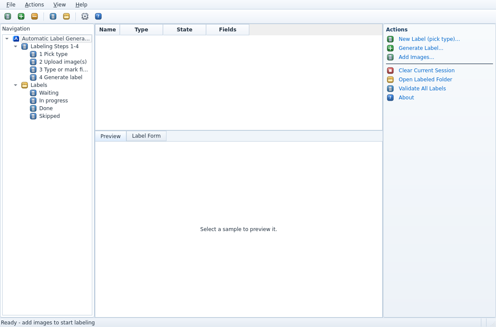
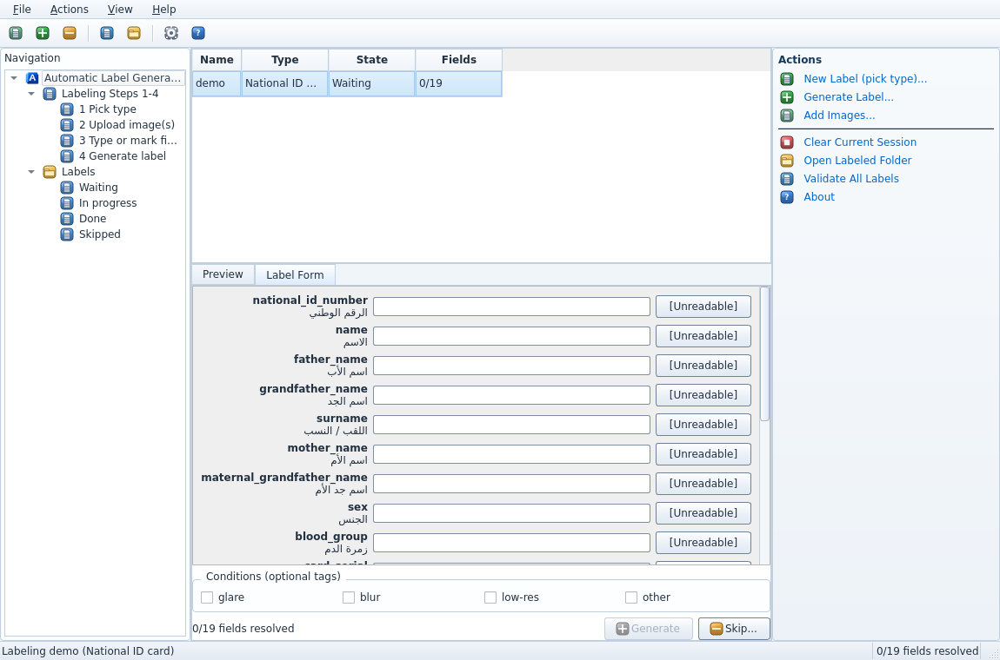

# A.L.G — Automatic Label Generator

The human-driven labeling tool for the training dataset: the
labeler picks the document type, uploads the image(s), types **every**
field or marks it `[UNREADABLE]`, and clicks **Generate** — which
produces the merged image (ID only) and the label JSON in the agreed
exact format.

> ⚠️ **Labels describe synthetic training data.** The label always
> records **what is printed** on the image, never what was intended.


## Screenshots

| Main window | Label form |
|---|---|
|  |  |

## Install & run (from source)

```powershell
cd ALG
pip install -r requirements.txt
python alg/main.py
```

No other repo folder is needed (the shared library is vendored in
`rfalib/`, byte-identical to `../RFG/rfalib` — enforced by CI). No
OpenCV / reportlab dependency.

Headless selftest (renders the Arabic probe, computes an MRZ probe,
verifies the label gate and the merge geometry; writes nothing, exit 0):

```powershell
python alg/main.py --selftest
```

## Workflow (the 4 labeling steps)

1. **Pick the input type** — ID / Tax card / Business license
   (Actions → *New Label (pick type)…* or *Add Images…*).
2. **Upload** — for the **ID two slots: front, then back** (both
   required); for TAX/LIC a single slot. *Add to queue* accepts more
   samples; PNG/JPEG only.
3. **Type or mark every field** — one row per field in the schema order;
   Arabic fields are RTL + right-aligned, MRZ/serials/dates are LTR.
   Each row has an **[Unreadable]** toggle and — only when the sample
   carries a truth sidecar from R.F.G — a **Use truth** button that fills
   the printed value as a *suggestion you must accept field-by-field*
   (nothing is auto-filled). Keyboard: `Ctrl+U` unreadable, `Ctrl+T`
   use truth, `Enter` next field, `Ctrl+G` generate.
   **Generate stays disabled until every field is either typed or
   `[UNREADABLE]`** — mixed junk is rejected.
   A resolved field receives a subtle green outline/glow; it clears again
   if you erase the text or unmark `[Unreadable]`.
4. **Generate** — merges the ID front+back with the exact same
   `rfalib.merge` as R.F.G (pixel-identical by construction), saves
   `labeled/<NAME>.png` (+ optional JPEG), writes
   `<NAME>.label.json` (the exact schema) and
   `<NAME>.label.sidecar.json`, marks the queue row Done and
   auto-advances to the next Waiting sample.

Condition tags (`glare`, `blur`, `low-res`, `other`) can be attached to
any sample. **Skip** requires a reason and writes the sidecar only.

## Outputs (workspace `labeled/`)

| File | Content |
|---|---|
| `ID_01.png` | the merged image (or the single TAX/LIC image), PNG |
| `ID_01.label.json` | the label: `photo` + the exact field schema |
| `ID_01.label.sidecar.json` | labeler, per-field status (`typed` / `accepted-truth` / `edited` / `unreadable`), truth disagreements, conditions, truth reference, split, synthetic flag |

Naming: sources matching `ID_01_front.png` + `ID_01_back.png` merge to
`ID_01.png`; external photos take the chosen type’s next counter.
Use **Actions → Reset Sequence Counters…** to reset ID, TAX, and LIC to
`_01`. Existing labeled files are kept; if a reset would reuse an existing
name, A.L.G skips that name so it cannot overwrite the earlier result.

**Validate All Labels** re-checks every `*.label.json` against the
schemas.

## Tests

```powershell
pip install -r requirements.txt pytest
pytest tests            # tests: label gate, queue, schema, normalize,
                        # merge (golden hash shared with RFG), GUI structure
```

## Packaging (Windows)

```powershell
.\packaging\build.ps1              # tests + selftest + PyInstaller + Inno Setup
.\packaging\build.ps1 -SkipInstaller
```

Produces `dist\ALG-Setup-x64.exe` — per-user install (no admin), desktop
+ Start-menu shortcuts with the blue-ribbon icon, full uninstaller (the
workspace in Documents is kept), silent install/uninstall via
`/SILENT` / `/VERYSILENT`.

## Repository layout

```
ALG/
├── README.md               this file
├── requirements.txt        pinned deps (no OpenCV / reportlab)
├── rfalib/                 vendored shared library (byte-identical to RFG/rfalib)
├── alg/
│   ├── main.py             entry point (GUI + --selftest)
│   ├── queue.py            sample queue + states + persistence
│   ├── label.py            label building, resolution gate, sidecars
│   └── ui/                 Aero-style windows, upload wizard, label form
├── tests/                  pytest suite
└── packaging/              alg.iss, icons/ALG.ico, build.ps1
```
