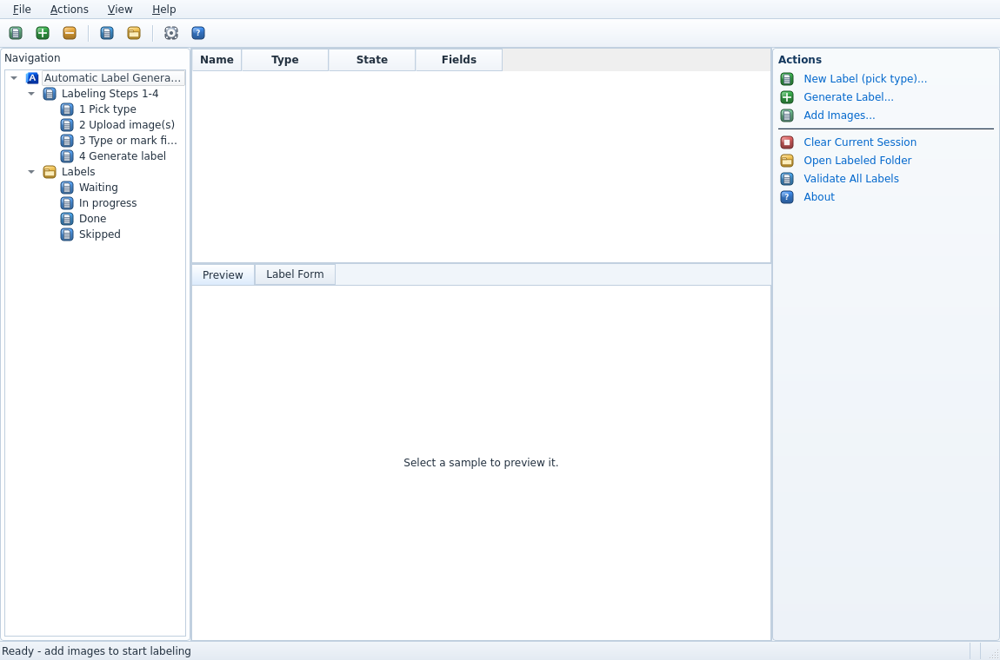
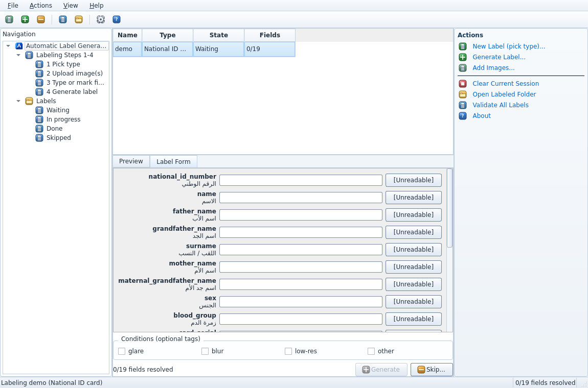

# A.L.G — Automatic Label Generator

The human-driven labeling tool for the training dataset: the
labeler picks the document type, uploads the image(s), types **every**
field or marks it `[UNREADABLE]`, and clicks **Generate** — which
produces the merged image (ID only) and the label JSON in the agreed
exact format.

> ⚠️ **Labels describe synthetic training data.** The label always
> records **what is printed** on the image, never what was intended.


## Screenshots

| Main window | Label form |
|---|---|
|  |  |

## Install & run (from source)

```powershell
cd Software\A.L.G
pip install -r requirements.txt
python alg/main.py
```

No sibling source folder is required; the supporting library is included
under `rfalib/`. No OpenCV / reportlab dependency.

Headless selftest (renders the Arabic probe, computes an MRZ probe,
verifies the label gate and the merge geometry; writes nothing, exit 0):

```powershell
cd Software\A.L.G
python alg/main.py --selftest
```

## Workflow (the 4 labeling steps)

1. **Pick the input type** — ID / Tax card / Business license
   (Actions → *New Label (pick type)…* or *Add Images…*).
2. **Upload** — for the **ID two slots: front, then back** (both
   required); for TAX/LIC a single slot. *Add to queue* accepts more
   samples; PNG/JPEG only.
3. **Type or mark every field** — one row per field in the schema order;
   Arabic fields are RTL + right-aligned, MRZ/serials/dates are LTR.
   Each row has an **[Unreadable]** toggle and — when the sample carries
   a truth sidecar — a **Use truth** button that fills
   the printed value as a *suggestion you must accept field-by-field*
   (nothing is auto-filled). Keyboard: `Ctrl+U` unreadable, `Ctrl+T`
   use truth, `Enter` next field, `Ctrl+G` generate.
   **Generate stays disabled until every field is either typed or
   `[UNREADABLE]`** — mixed junk is rejected.
   A resolved field receives a subtle green outline/glow; it clears again
   if you erase the text or unmark `[Unreadable]`.
4. **Generate** — merges the ID front+back with `rfalib.merge`, saves
   `labeled/<NAME>.png` (+ optional JPEG), writes
   `<NAME>.label.json` (the exact schema) and
   `<NAME>.label.sidecar.json`, marks the queue row Done and
   auto-advances to the next Waiting sample.

Condition tags (`glare`, `blur`, `low-res`, `other`) can be attached to
any sample. **Skip** requires a reason and writes the sidecar only.

**Merge width.** The ID merge scales both sides to one width (Settings →
merge width, 1000-1600 px; never smaller than the larger upload). The
default is **1600**, the width of the project dataset and of the GATE Block
(`main/GATE Block/config/id_merge.yaml`): with the same width an ID merged
here and one merged by the gate are the same pixels (a test in the GATE
Block checks it on phone photos). Keep them equal if you change either.
Phone photos are merged upright (their EXIF rotation is applied), as every
viewer shows them.

## Outputs (workspace `labeled/`)

| File | Content |
|---|---|
| `ID_01.png` | the merged image (or the single TAX/LIC image), PNG |
| `ID_01.label.json` | the label: `photo` + the exact field schema |
| `ID_01.label.sidecar.json` | labeler, per-field status (`typed` / `accepted-truth` / `edited` / `unreadable`), truth disagreements, conditions, truth reference, split, synthetic flag |

Naming: sources matching `ID_01_front.png` + `ID_01_back.png` merge to
`ID_01.png`; external photos take the chosen type’s next counter.
Use **Actions → Reset Sequence Counters…** to reset ID, TAX, and LIC to
`_01`. Existing labeled files are kept; if a reset would reuse an existing
name, A.L.G skips that name so it cannot overwrite the earlier result.

**Validate All Labels** re-checks every `*.label.json` against the
schemas.

## Tests

```powershell
cd Software\A.L.G
pip install -r requirements.txt pytest
pytest tests            # tests: label gate, queue, schema, normalize,
                        # merge geometry and output, GUI structure
```

## MCP server (optional)

The companion MCP server lets an MCP-capable agent draft labels through the
same schemas and validation rules. Its source, setup guide, requirements, and
tests are in [`mcp/`](mcp/README.md). AI labels go to `ai_labeled/` for review
before they are promoted into `labeled/`. The server checks the MRZ in code but
never asks an agent to change a character it read correctly: printed cards can
carry a wrong check digit, and the label must be what is printed.

## Labeling the photographed print run

The project dataset is 90 fictional identities — a national ID (front and back, no portrait), a tax
card and a company licence each — made by Z.ai's *Synthetic KYC Dataset Builder* (ReportLab print
sheets, 31 Oct 2026, `printables/*_print_sheets.pdf`), printed, cut out and photographed in ten
conditions (`Datasets/<split>/business_NNNN/<kind>/print_001/<condition>/`).

**The CSV is not what is printed.** The generator put several values in the wrong row, left template
placeholders on the cards and used values no Iraqi document carries. A label must be what is printed —
that is what OCR has to read — so the labels follow the paper, not `printables/ground_truth/*.csv`:

| Document | Row on the card (A.L.G field) | Printed | The CSV says |
|---|---|---|---|
| ID front | الجد (`grandfather_name`) | «أي» + the grandfather's name | the name alone |
| ID front | اللقب (`surname`) | «أي نص» ("any text"), the template placeholder, on every card | the surname |
| ID front | الجد under الأم (`maternal_grandfather_name`) | the surname | (never generated) |
| ID front | vertical number on the right edge (sidecar only) | `000000` on every card | — |
| Licence | الغايات (`business_purposes`) | the head-office address | (never generated) |
| Licence | المركز الرئيسي (`head_office`) | the founders' names | the address |

and these are printed as in the CSV, but unlike a real Iraqi document:

* national number: 13 digits on all 90 cards (10 start with 0); Iraqi ones have 12
* family number: any two letters where the schema expects `L` and `M`
* sex: «انثى» without the hamza on the 19 female cards
* MRZ line 2: the composite check digit does not follow ICAO 9303 (it matches on 9 of 90 cards, what chance gives)
* licence capital in Syrian pounds («ل.س») on all 90; every address is in a Syrian city
  (دمشق 35, حمص 18, دير الزور 11, حلب 10, حماة 9, اللاذقية 7) and has two parts (city - street)
* expired before the print run: 59 tax cards, 62 licences, 9 IDs (not an error of the generator, but the
  KYC agent has to notice it)

**How the labels get there.** `rfalib/printed_truth.py` turns each CSV row into what is printed in each
field position (`printed`), what the generator meant (`intended`, for the later cross-document checks,
never a label), every deviation (`defects`, `notes`) and the formats this print run uses
(`known_deviations`). `tools/prepare_photos.py` puts every photo into an inbox under an A.L.G name with a
truth sidecar of its own:

```powershell
cd Software\A.L.G
python tools\prepare_photos.py --dataset D:\Desktop\dataset --inbox D:\Desktop\dataset\alg_inbox --gate "..\..\main\GATE Block"
```

* `ID_1203_glare_front.jpg` + `_back.jpg` + `ID_1203.truth.json`: identity 012, its third ID photo; the
  number is identity × 100 + photo, so several photos of one card never share a name.
* The ID's front and back are told apart by the file name (`front` / `back` in it) or, when the name does
  not say (WhatsApp names), by the GATE Block's Gate 1 (`--gate`).
* Photos are hard-linked, not copied (no extra disk space; HEIC or WebP photos are converted to JPEG,
  upright), the dataset folder is not changed, and `manifest.csv` remembers what is prepared, so the
  command can be rerun as photos come in.

In the app, **Use truth** then fills the printed text; in the MCP server the agents still label blind
and are compared with it afterwards. The format check accepts the declared formats of the print run (a
13-digit national number, «ل.س», a placeholder surname that cannot match the MRZ ...) instead of asking
for an exception on every card; a value that fits neither format still warns. The label sidecar and the
MCP audit list which fields used a declared format.

**How the mapping was checked.** `tools/verify_printed_truth.py` reads every field of the 90 × 4 printed
documents on the print sheets with Tesseract and checks that the same text always gives the same pixels:
in all 503 readings of the six fields whose print differs from the CSV, the text Tesseract read is closer
to the printed value than to the CSV column (the 37 fields it could not read at all were checked by eye);
every value that occurs on several cards gives the same pixels on all of them (each such card looks more
like the other cards of its value than like any other value; the one near-tie, a licence capital of
15,000,000,000 against 13,000,000,000, one digit apart, is read correctly by Tesseract); the letter
«A» before the card number is the same on all 90 cards (design, not data); and dates, numbers and MRZ
lines read back at 99.5-100 % character agreement. Run it again after any change to the mapping:

```powershell
python tools\verify_printed_truth.py --dataset D:\Desktop\dataset --layouts "..\..\main\GATE Block\templates" --out verify
```

(needs Tesseract with the `ara` language and poppler's `pdfimages`; `verify/contact/*.html` shows every
card's crop next to the label text, for the eye).

## Packaging (Windows)

```powershell
cd Software\A.L.G
.\packaging\build.ps1              # tests + selftest + PyInstaller + Inno Setup
.\packaging\build.ps1 -SkipInstaller
```

Produces `dist\ALG-Setup-x64.exe` — per-user install (no admin), desktop
+ Start-menu shortcuts with the blue-ribbon icon, full uninstaller (the
workspace in Documents is kept), silent install/uninstall via
`/SILENT` / `/VERYSILENT`.

## Repository layout

```
A.L.G/
├── README.md               this file
├── requirements.txt        pinned deps (no OpenCV / reportlab)
├── rfalib/                 supporting library used by A.L.G
├── alg/
│   ├── main.py             entry point (GUI + --selftest)
│   ├── queue.py            sample queue + states + persistence
│   ├── label.py            label building, resolution gate, sidecars
│   └── ui/                 Aero-style windows, upload wizard, label form
├── tests/                  pytest suite
├── tools/                  prepare_photos.py, verify_printed_truth.py (the print run)
├── mcp/                    optional MCP server, setup guide, and MCP tests
└── packaging/              alg.iss, icons/ALG.ico, build.ps1
```
